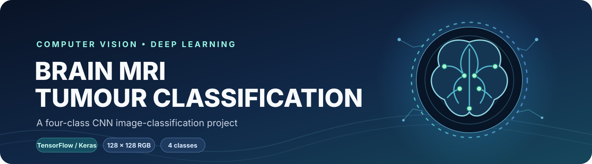
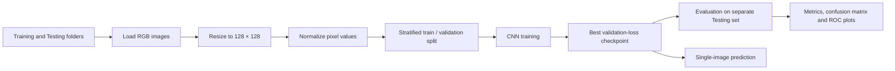
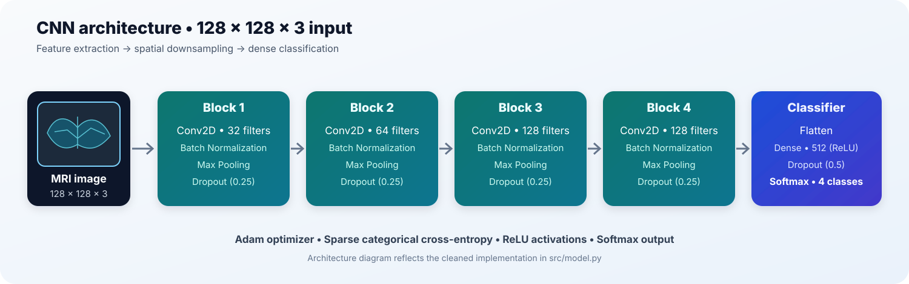
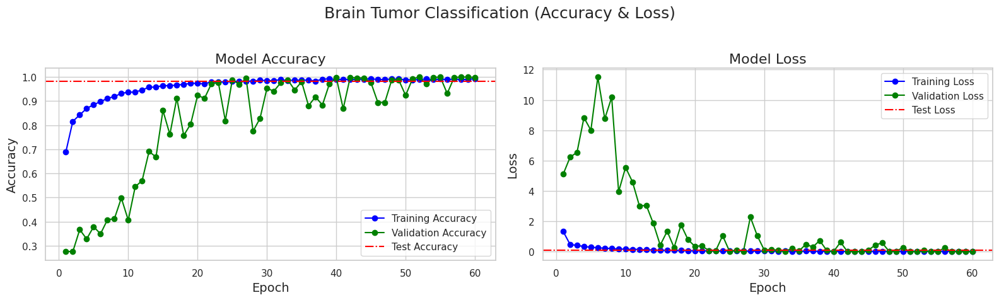
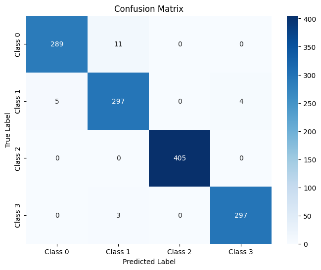
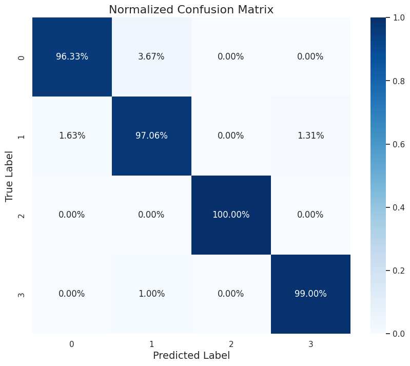
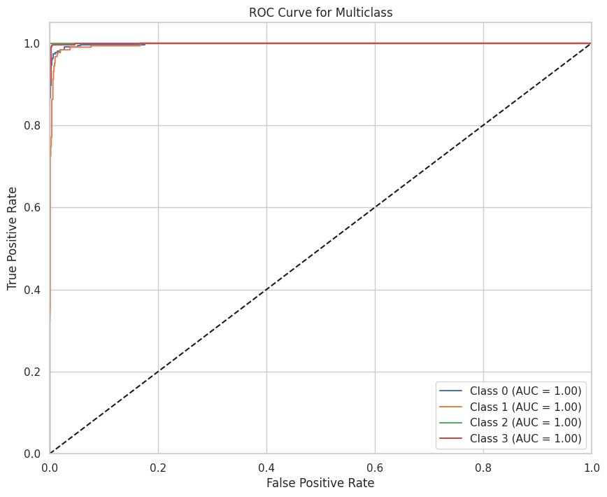

<div align="center">
  

  <p>
    
    
    
    
    
  </p>

  <h3>Classifying four MRI image categories with a convolutional neural network</h3>
  <p>TensorFlow · Keras · CNN · Computer Vision · Image Classification</p>
</div>

> **Medical-use disclaimer:** This repository is an educational machine-learning project. It is not a medical device and must not be used to diagnose, rule out, screen for, or make treatment decisions about a medical condition. Predictions require qualified clinical interpretation.

---

## Contents

- [Project overview](#-project-overview)
- [Dataset classes](#-dataset-classes)
- [Visual workflow](#-visual-workflow)
- [CNN architecture](#-cnn-architecture)
- [Repository structure](#-repository-structure)
- [Dataset setup](#-dataset-setup)
- [Installation](#-installation)
- [Training](#-training)
- [Evaluation](#-evaluation)
- [Single-image prediction](#-single-image-prediction)
- [Original notebook results](#-original-notebook-results)
- [Limitations and responsible use](#-limitations-and-responsible-use)
- [Dataset attribution](#-dataset-attribution)

## 🧠 Project overview

This project explores **multi-class brain MRI image classification** using a custom convolutional neural network (CNN) implemented with TensorFlow and Keras. The repository brings together the original notebook experiment and two earlier Python implementations, alongside a more structured training, evaluation, and inference pipeline.

The cleaned implementation uses **128 × 128 RGB images** and predicts one of four dataset folder classes. Class names are discovered from the dataset directory and stored in metadata so that the same label mapping is used during inference.

<div align="center">
  <table>
    <tr>
      <td align="center"><h2>4</h2><sub>Image classes</sub></td>
      <td align="center"><h2>128 × 128</h2><sub>Input resolution</sub></td>
      <td align="center"><h2>16</h2><sub>Default batch size</sub></td>
      <td align="center"><h2>60</h2><sub>Maximum epochs</sub></td>
    </tr>
  </table>
</div>

## 🔬 Dataset classes

For the commonly used dataset folder layout, the four classes are:

| Class folder | Description |
|---|---|
| `glioma` | MRI images labelled as glioma |
| `meningioma` | MRI images labelled as meningioma |
| `notumor` | MRI images labelled as no tumour |
| `pituitary` | MRI images labelled as pituitary tumour |

The original notebook uses Keras directory loading, which assigns labels according to the sorted folder names. The cleaned pipeline discovers and records the actual class-name mapping at runtime rather than assuming a fixed mapping. The data is not included in this repository.

## 🔁 Visual workflow



The validation partition is created from the `Training` folder using a fixed random seed and stratification. The separate `Testing` folder is held aside for final evaluation.

## 🏗️ CNN architecture

The cleaned model contains four convolutional feature-extraction blocks followed by a dense classifier. Each convolutional block applies batch normalization, max pooling, and dropout.

<div align="center">
  
  <sub>Architecture represented by <code>src/model.py</code>.</sub>
</div>

**Training configuration**

| Setting | Value |
|---|---|
| Framework | TensorFlow / Keras |
| Input shape | `128 × 128 × 3` |
| Output classes | 4 |
| Optimizer | Adam |
| Loss | Sparse categorical cross-entropy |
| Hidden-layer activation | ReLU |
| Output activation | Softmax |
| Batch size | 16 (default) |
| Maximum epochs | 60 |
| Validation split | 10% of the Training folder |

## 📁 Repository structure

```text
brain-mri-tumor-classification/
├── assets/
│   ├── project-banner.svg
│   └── cnn-architecture.svg
├── src/
│   ├── __init__.py
│   ├── config.py
│   ├── data.py
│   ├── model.py
│   ├── train.py
│   ├── evaluate.py
│   ├── predict.py
│   └── utils.py
├── notebooks/
│   └── MRI_original.ipynb
├── original_files/
│   ├── MRI_original.py
│   └── MRImul_original.py
├── results/
│   └── original_notebook/
│       ├── confusion_matrix.png
│       ├── normalized_confusion_matrix.png
│       ├── training_curves.png
│       └── roc_curves.png
├── artifacts/              # generated model files; not committed by default
├── README.md
├── LICENSE_NOTE.md
├── requirements.txt
├── requirements-dev.txt
└── .gitignore
```

### What's included

| File | Purpose |
|---|---|
| `src/model.py` | Defines and compiles the CNN model |
| `src/data.py` | Loads images, normalizes pixels and creates stratified splits |
| `src/train.py` | Trains the CNN and saves checkpoints and training history |
| `src/evaluate.py` | Computes evaluation metrics and saves plots/reports |
| `src/predict.py` | Runs inference on one MRI image |
| `src/config.py` | Central configuration and default paths |
| `notebooks/MRI_original.ipynb` | Original notebook and saved experiment outputs |
| `original_files/` | Earlier 128 × 128 and 64 × 64 Python experiments |

The earlier `MRI.py` experiment used 128 × 128 images and a 60-epoch training setup. `MRImul.py` used 64 × 64 images and 20 epochs. The cleaned implementation follows the main notebook's 128 × 128 direction, with a lower default batch size to reduce memory requirements.

## 📦 Dataset setup

The dataset is **not included** in this repository. Obtain it directly from its Kaggle source and review the current licence, attribution, and usage terms:

**[Brain Tumor MRI Dataset — Kaggle](https://www.kaggle.com/datasets/masoudnickparvar/brain-tumor-mri-dataset)**

After configuring Kaggle CLI credentials on your own machine, run the following from the repository root:

```bash
pip install kaggle
kaggle datasets download -d masoudnickparvar/brain-tumor-mri-dataset -p data --unzip
```

Expected directory layout:

```text
data/
├── Training/
│   ├── glioma/
│   ├── meningioma/
│   ├── notumor/
│   └── pituitary/
└── Testing/
    ├── glioma/
    ├── meningioma/
    ├── notumor/
    └── pituitary/
```

If the archive extracts these folders inside an additional directory, provide that directory through `--dataset-dir`. **Never commit `kaggle.json`, API keys, or dataset images to GitHub.** Review the dataset conditions before redistributing any data or derived model weights.

## ⚙️ Installation

Python 3.10–3.12 is recommended. Create a virtual environment and install the dependencies:

```bash
python -m venv .venv

# Windows PowerShell
.venv\Scripts\Activate.ps1

# Linux / macOS / WSL
source .venv/bin/activate

python -m pip install --upgrade pip
pip install -r requirements.txt
```

TensorFlow installation support can vary by operating system, Python version, and hardware. Use the [official TensorFlow installation guide](https://www.tensorflow.org/install) if installation fails.

## 🚀 Training

Run from the repository root:

```bash
python -m src.train
```

To override the default configuration:

```bash
python -m src.train \
  --dataset-dir data \
  --image-size 128 \
  --batch-size 16 \
  --epochs 60 \
  --validation-split 0.10 \
  --seed 42 \
  --output-dir artifacts
```

On Windows PowerShell, enter the command on one line or replace the Unix `\` line continuations with PowerShell backticks.

The training script creates the model checkpoint and supporting metadata/history files, including:

- `artifacts/best_model.keras` — checkpoint selected using validation loss.
- `artifacts/final_model.keras` — final model after training/early stopping.
- `artifacts/metadata.json` — class names and preprocessing metadata.
- `artifacts/training_log.csv` and `artifacts/training_history.json` — training history.
- `artifacts/training_history.png` — training and validation curves.

## 📊 Evaluation

After training, evaluate against the separate `Testing` directory:

```bash
python -m src.evaluate
```

Optional arguments:

```bash
python -m src.evaluate \
  --dataset-dir data \
  --model-path artifacts/best_model.keras \
  --metadata-path artifacts/metadata.json \
  --output-dir results
```

The evaluation pipeline reports accuracy, weighted precision, weighted recall, weighted F1, macro F1, loss, per-class precision/recall/F1, a confusion matrix, and one-vs-rest ROC curves. Generated reports and plots are written under `results/`.

### Visuals from the original notebook

The images below are saved outputs from the **uploaded original notebook**. They document that historical experiment; they are not results freshly generated by the cleaned pipeline. In the confusion-matrix plots, labels `Class 0`–`Class 3` follow the alphabetically sorted folder order shown in the dataset table above.

<div align="center">
  <p><strong>Training and validation curves</strong></p>
  
  <p><strong>Confusion matrix and class-normalized confusion matrix</strong></p>
  
  
  <p><strong>One-vs-rest ROC curves</strong></p>
  
</div>

## 🖼️ Single-image prediction

Once a model and metadata have been generated by training, run:

```bash
python -m src.predict path/to/mri_image.jpg
```

You can also pass explicit model and metadata paths:

```bash
python -m src.predict path/to/mri_image.jpg \
  --model-path artifacts/best_model.keras \
  --metadata-path artifacts/metadata.json
```

The input image is resized to the model's configured dimensions and normalized to `[0, 1]`, matching the training preprocessing. Prediction output is a model classification result, not a clinical conclusion.

## 📈 Original notebook results

The uploaded notebook contains saved evaluation output reporting the following values:

| Metric | Notebook-reported value |
|---|---:|
| Test images | 1,311 |
| Test accuracy | **98.25%** |
| Weighted precision | 98.26% |
| Weighted recall | 98.25% |
| Weighted F1-score | 98.25% |
| Test loss | 0.0938 |
| Overall one-vs-rest ROC AUC | 1.00 (rounded to two decimal places) |

<blockquote>
  <strong>Reproducibility note:</strong> These are historical outputs saved in the supplied notebook. They have not been reproduced by the cleaned implementation in this repository. Re-run training and evaluation before presenting them as results of the cleaned code. The displayed AUC is rounded and should not be interpreted as an exact value of 1.0.
</blockquote>

## ⚠️ Limitations and responsible use

- This project is for learning and experimentation only; it is not validated for clinical use.
- The cleaned pipeline uses a deterministic, stratified validation split from the `Training` directory. The separate `Testing` directory remains reserved for evaluation.
- Class names are discovered from folder names and stored in metadata. Use the same metadata with the trained model during inference.
- Performance on one public dataset does not establish generalization to other hospitals, scanners, populations, or image-acquisition protocols.
- Dataset duplicates, leakage, class imbalance, external validation, calibration, and clinically meaningful sensitivity/specificity should be investigated before research or deployment claims.
- Do not use the output to make patient-care decisions.

## 📚 Dataset attribution

The original notebook downloaded `masoudnickparvar/brain-tumor-mri-dataset` from Kaggle. Cite the dataset and follow the current Kaggle page's licence, attribution, and usage conditions when using it. Dataset images, Kaggle credentials, and trained model weights are intentionally not included here. Before publishing weights trained on these images, verify that the applicable terms permit sharing derived models.

## 👨‍💻 Author

**Rahul Sinha**  
[GitHub](https://github.com/Rahul-DSAI) · [LinkedIn](https://www.linkedin.com/in/rahul-sinha99/)

---

<div align="center">
  <sub>Built as an applied computer-vision learning project with Python, TensorFlow, and Keras.</sub>
</div>
