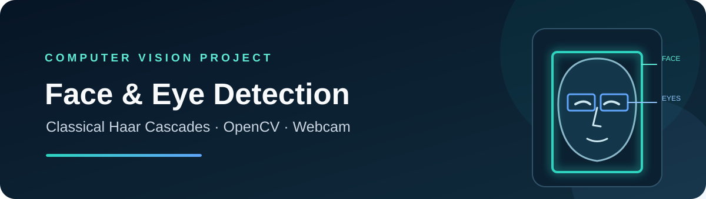
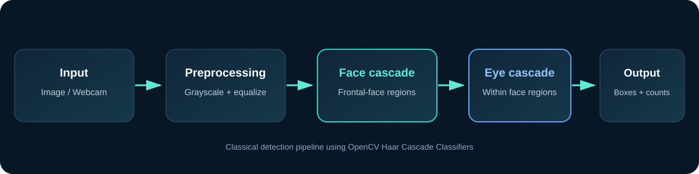

<div align="center">
  

  <p>
    
    
    
    
  </p>
</div>

# Face & Eye Detection with OpenCV

A personal computer-vision project that detects frontal faces and eyes in still images using OpenCV Haar Cascade Classifiers, with a separate webcam mode for live face detection. The repository includes a cleaned, reusable Python implementation alongside the original Jupyter notebook.

## Project overview

- **Face detection:** locates frontal faces with `haarcascade_frontalface_default.xml`.
- **Eye detection:** searches for eyes inside each detected face region with `haarcascade_eye_tree_eyeglasses.xml`.
- **Image mode:** saves an annotated copy of an input image and prints detection coordinates/counts.
- **Webcam mode:** processes camera frames and displays detected face regions in real time.
- **No model training required:** Haar cascade XML files are loaded from the installed OpenCV package.

## Workflow

<div align="center">
  
</div>

1. Read an image or webcam frame.
2. Convert the frame to grayscale and equalize its histogram.
3. Apply the frontal-face Haar cascade.
4. Optionally apply the eye cascade within each detected face region.
5. Draw bounding boxes and display detection counts.

## Tech stack

| Component | Technology |
|---|---|
| Language | Python |
| Computer vision | OpenCV (`opencv-python`) |
| Numerical arrays | NumPy |
| Detection method | Haar Cascade Classifiers |
| Development artifact | Jupyter Notebook |

## Repository structure

```text
face-eye-detection-opencv/
├── docs/
│   ├── project-banner.svg
│   └── workflow.svg
├── notebooks/
│   └── original-computer-vision-notebook.ipynb
├── src/
│   └── face_detection/
│       ├── __init__.py
│       ├── detector.py
│       ├── detect_image.py
│       └── webcam.py
├── tests/
│   └── test_detector.py
├── .gitignore
├── LICENSE_NOTE.md
├── pyproject.toml
└── requirements.txt
```

## Getting started

### 1. Clone the repository

```bash
git clone https://github.com/<YOUR_GITHUB_USERNAME>/face-eye-detection-opencv.git
cd face-eye-detection-opencv
```

### 2. Create a virtual environment

```bash
python -m venv .venv
```

Activate it:

```powershell
# Windows PowerShell
.venv\Scripts\Activate.ps1
```

```bash
# macOS / Linux
source .venv/bin/activate
```

### 3. Install dependencies

```bash
python -m pip install --upgrade pip
pip install -r requirements.txt
pip install -e .
```

## Run face and eye detection on an image

```bash
python -m face_detection.detect_image path/to/image.jpg
```

The annotated result is saved by default to `outputs/face-detection-result.jpg`.

Set a custom output path:

```bash
python -m face_detection.detect_image path/to/image.jpg \
  --output outputs/my-result.jpg
```

Skip eye detection:

```bash
python -m face_detection.detect_image path/to/image.jpg --no-eyes
```

Tune the Haar cascade parameters:

```bash
python -m face_detection.detect_image path/to/image.jpg \
  --scale-factor 1.1 \
  --min-neighbors 5 \
  --min-size 30 30
```

## Run webcam face detection

Connect a webcam and run:

```bash
python -m face_detection.webcam
```

Press **Q** in the video window to stop. For a different camera device:

```bash
python -m face_detection.webcam --camera 1
```

The webcam script also detects eyes by default. Use `--no-eyes` to disable that step.

## Python usage

```python
import cv2
from face_detection import HaarFaceEyeDetector

image = cv2.imread("path/to/image.jpg")
if image is None:
    raise FileNotFoundError("Could not read the input image")

detector = HaarFaceEyeDetector()
annotated, result = detector.detect(image, detect_eyes=True)

print("Faces:", result["face_count"])
print("Eyes:", result["eye_count"])
cv2.imwrite("outputs/result.jpg", annotated)
```

The returned metadata contains each face bounding box as `[x, y, width, height]` and the eye boxes relative to that face region.

## Original notebook

The original notebook is preserved at [`notebooks/original-computer-vision-notebook.ipynb`](notebooks/original-computer-vision-notebook.ipynb). Its face/eye section includes a sample image result showing **3 detected faces and 4 detected eyes** in that particular notebook output. This is an example output, not an accuracy benchmark.

The notebook also contains separate computer-vision exercises for colored-image denoising, adding Gaussian noise, and generating a noisy video. Those experiments are retained in the original notebook but are not part of the cleaned face-detection command-line implementation.

Some notebook cells rely on Google Drive, `image_common_utils.py`, and local `computer_vision/` image paths that were not included with the uploaded notebook. The cleaned scripts in `src/` do not depend on those missing assets.

## Tests

Install the development dependency and run:

```bash
pip install pytest
pytest -q
```

## Limitations

- Haar cascades are classical feature-based detectors, not deep-learning models.
- The selected face cascade is intended primarily for frontal faces; profile views, occlusion, unusual poses, poor lighting, and low-resolution frames can reduce detection quality.
- Haar detections can produce false positives or miss faces. The notebook does not provide a labelled test set or measured precision/recall, so no benchmark accuracy is claimed.
- Eye detections are approximate regions and are not a medical or identity-related assessment.
- Webcam use requires local camera permission and a working camera device.

## Privacy and responsible use

This project processes images locally and does not include a face-recognition or identity-matching feature. Use images and cameras only when you have the appropriate permission, and avoid publishing identifiable images of people without their consent.

## Author

**Rahul Sinha**  
GitHub: [@Rahul-DSAI](https://github.com/Rahul-DSAI)

---

<div align="center">
  <sub>Built as a personal computer-vision learning and portfolio project.</sub>
</div>
