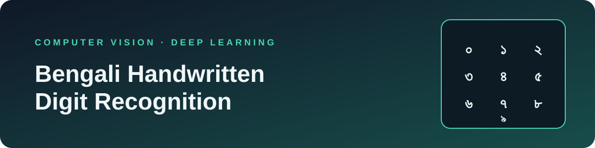
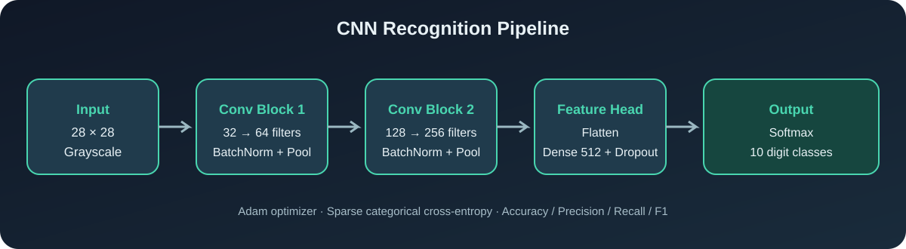

<div align="center">
  

  <br/>
  
  
  
  
</div>

# Bengali Handwritten Digit Recognition with CNN

A personal computer-vision project for classifying Bengali handwritten digit images into ten classes using a convolutional neural network (CNN) built with TensorFlow/Keras. The original experiments explored directory-based RGB images and TIFF-based grayscale images; this maintained version standardizes the input to **28 × 28 grayscale** and provides a reproducible data-preparation, training, evaluation and prediction workflow.

> **Project scope:** image-level classification of a single digit. This is not a document OCR system and does not detect multiple digits in a full page.

## Highlights

- 10-class handwritten digit classification (class folders `0` through `9`).
- 28 × 28 grayscale input images.
- CNN with convolution, batch normalization, max pooling, dropout and a 10-class softmax head.
- Reproducible, stratified train/validation/test split from class-organized images.
- TIFF/JPEG/PNG/BMP/WebP source images converted to consistent grayscale PNG files.
- Training callbacks, model checkpoints, CSV logs and learning-curve plots.
- Held-out test evaluation with accuracy, weighted precision, recall, F1-score and confusion matrix.
- Single-image prediction script.

## Model architecture

<div align="center">
  
</div>

The network follows the structure explored in the original scripts: convolutional blocks with 32, 64, 128 and 256 filters, batch normalization, max pooling and dropout, followed by a 512-unit dense layer and a softmax output. Pixel rescaling and mild rotation/zoom augmentation are included in the maintained model.

## Repository structure

```text
bengali-digit-recognition/
├── README.md
├── LICENSE_NOTE.md
├── requirements.txt
├── pyproject.toml
├── docs/
│   ├── project-banner.svg
│   ├── architecture.svg
│   └── original-code-review.md
├── experiments/
│   ├── ORIGINAL_FILE_MAP.md
│   └── original_versions/       # Six distinct uploaded script versions
├── src/
│   └── bengali_digit_recognition/
│       ├── config.py
│       ├── data.py
│       ├── model.py
│       ├── prepare_data.py
│       ├── train.py
│       ├── evaluate.py
│       └── predict.py
└── tests/
    └── test_data.py
```

## Dataset layout

The uploaded files refer to local datasets organised into class folders. The dataset itself was not included. Place the source data in a directory with ten subfolders named exactly `0` through `9`:

```text
data/raw/
├── 0/
│   ├── sample_001.tif
│   └── sample_002.tif
├── 1/
├── 2/
├── 3/
├── 4/
├── 5/
├── 6/
├── 7/
├── 8/
└── 9/
```

The folder names define the class mapping. The preparation script converts supported images to 28 × 28 grayscale PNG files and creates a stratified **80% train / 10% validation / 10% test** split. This is the maintained project's new reproducible split; it is not claimed to be the exact split used in the earlier experiments.

## Installation

Python 3.10 or newer is recommended.

```bash
# Clone the repository
git clone https://github.com/<YOUR_GITHUB_USERNAME>/bengali-digit-recognition.git
cd bengali-digit-recognition

# Create and activate a virtual environment
python -m venv .venv
# Windows PowerShell:
.venv\Scripts\Activate.ps1
# macOS / Linux:
# source .venv/bin/activate

# Install the project and development tools
python -m pip install --upgrade pip
pip install -e ".[dev]"
```

TensorFlow installation can depend on your operating system, Python version and available accelerator. Follow the TensorFlow installation instructions for your environment if the default dependency installation is not suitable.

## 1. Prepare the dataset

```bash
python -m bengali_digit_recognition.prepare_data \
  --source data/raw \
  --output data/processed \
  --train-ratio 0.8 \
  --val-ratio 0.1 \
  --test-ratio 0.1 \
  --seed 42
```

Windows PowerShell:

```powershell
python -m bengali_digit_recognition.prepare_data `
  --source "D:\datasets\bengali_digits" `
  --output "data\processed" `
  --train-ratio 0.8 `
  --val-ratio 0.1 `
  --test-ratio 0.1 `
  --seed 42
```

The output contains `train/`, `val/` and `test/` class folders plus `split_manifest.csv`. The manifest records which source file was assigned to each split. The script refuses to replace a non-empty output directory unless `--overwrite` is explicitly supplied.

## 2. Train the CNN

```bash
python -m bengali_digit_recognition.train \
  --data data/processed \
  --output artifacts \
  --epochs 30 \
  --batch-size 64 \
  --seed 42
```

Training saves:

- `artifacts/best_model.keras` — checkpoint with the best validation accuracy.
- `artifacts/final_model.keras` — final model after early stopping restores the best validation weights.
- `artifacts/training_log.csv` and `artifacts/history.json` — training history.
- `artifacts/figures/training_curves.png` — loss and accuracy curves.

## 3. Evaluate on the held-out test set

```bash
python -m bengali_digit_recognition.evaluate \
  --data data/processed \
  --model artifacts/best_model.keras \
  --output artifacts/evaluation
```

The evaluation script reports accuracy, weighted precision, weighted recall and weighted F1. It also saves a classification report, confusion matrix CSV and confusion matrix image. Use the held-out test metrics when reporting model performance; do not report training accuracy as test accuracy.

## 4. Predict one digit image

```bash
python -m bengali_digit_recognition.predict path/to/handwritten-digit.png \
  --model artifacts/best_model.keras
```

The command prints the predicted class, confidence and probabilities for all ten classes. Input images are converted to grayscale and resized to 28 × 28. The image background/foreground polarity should match the training data; the prediction script does not automatically invert images.

## Testing

```bash
pytest
```

The tests cover class-folder discovery, stratified splitting, grayscale image conversion, output dimensions, overwrite protection and prediction preprocessing. TensorFlow training and model inference should additionally be tested in an environment where TensorFlow is installed.

## Original experiments and code review

The uploaded files contained six distinct script variants and six exact duplicate uploads. The distinct source versions are preserved under `experiments/original_versions/`; duplicate names and their hashes are listed in [`experiments/ORIGINAL_FILE_MAP.md`](experiments/ORIGINAL_FILE_MAP.md). Machine-specific Windows paths were replaced with example dataset paths in the archived copies.

The original experiments included:

- Directory-based 28 × 28 RGB input pipelines with 30 training epochs.
- TIFF-based 28 × 28 grayscale pipelines with 30- and 100-epoch experiments.
- Data augmentation using rotation, zoom and shear.
- Training/validation plots and, in one script, weighted precision, recall, F1 and a confusion matrix.

Several original scripts contain dataset split and preprocessing inconsistencies. The maintained code addresses these with a file-level stratified split, explicit grayscale conversion and consistent inference preprocessing. A detailed review is available in [`docs/original-code-review.md`](docs/original-code-review.md).

## Results and reproducibility

No trained model checkpoint, source dataset or saved numerical evaluation output was included with the uploaded scripts. Therefore, this repository does **not** claim a verified accuracy, precision, recall or F1 score. Run the documented training and evaluation pipeline to generate reproducible metrics on your dataset.

## Limitations and next steps

- Confirm the dataset's provenance, license and exact class-label mapping before redistribution or publication.
- Verify whether the ten folder labels correspond to the intended Bengali digit glyphs and preserve that mapping in the dataset documentation.
- Evaluate on a genuinely held-out test set and inspect per-class errors.
- Compare the baseline CNN with a smaller model and a modern augmentation strategy.
- Test robustness to stroke thickness, writing style, rotation, scan quality and background variations.
- A future OCR extension would need line/character segmentation and sequence decoding; this repository currently classifies one digit image at a time.

## Maintainer

**Rahul Sinha** — [GitHub](https://github.com/Rahul-DSAI) · [LinkedIn](https://www.linkedin.com/in/rahul-sinha99/)

This repository presents a cleaned, independently maintained portfolio implementation based on the supplied experiments. It does not imply that every original experiment was developed individually.
