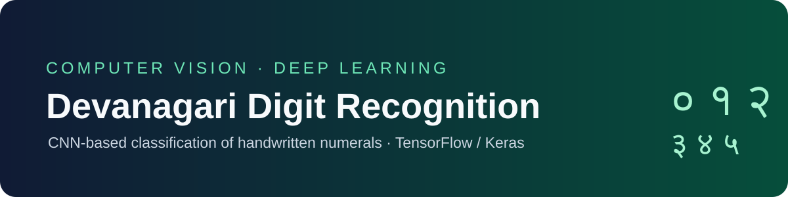
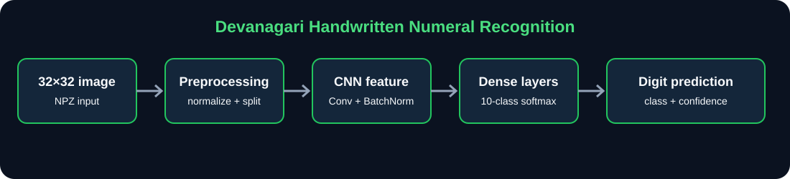

<div align="center">
  

  <br/>
  
  
  
  
</div>

# Devanagari Handwritten Digit Recognition

A convolutional neural network (CNN) project for classifying handwritten Devanagari numerals into ten classes. The original experiment uses the CMATERdb Devanagari numerals NPZ training and testing files with TensorFlow/Keras.

> **Scope:** This is an academic computer-vision project. The supplied dataset is not included. No test accuracy is claimed until the complete training and evaluation pipeline is run on the original dataset files.

## Project overview

| Item | Details |
|---|---|
| Task | Ten-class handwritten numeral classification |
| Dataset format | NumPy `.npz` archives |
| Dataset referenced by original script | CMATERdb Devanagari numerals |
| Input in original model | 32 × 32 × 3 |
| Model | Sequential CNN with convolution, batch normalization and dense layers |
| Optimizer | Adam |
| Loss | Sparse categorical cross-entropy |
| Original training configuration | 40 epochs, batch size 16 |

## Architecture



The cleaned implementation keeps the original CNN structure while adding a stratified validation split, best-checkpoint saving, early stopping, training logs and evaluation reports. Mild rotation, translation and zoom augmentations are used. Horizontal flipping is intentionally omitted because mirroring a numeral can change its identity.

## Repository structure

```text
devanagari-digit-recognition/
├── README.md
├── requirements.txt
├── pyproject.toml
├── src/devanagari_recognition/
│   ├── data.py       # NPZ loading, normalization and label mapping
│   ├── model.py      # CNN architecture
│   ├── train.py      # Training and checkpoint creation
│   ├── evaluate.py   # Test metrics and confusion matrix
│   └── predict.py    # Single-image inference
├── experiments/
│   └── original-debnagari.py
├── tests/
├── docs/
│   ├── architecture.svg
│   ├── project-banner.svg
│   └── original-code-review.md
├── data/             # Add dataset locally; ignored by Git
├── models/           # Generated model files; ignored by Git
└── reports/          # Generated evaluation outputs; ignored by Git
```

## Dataset setup

Obtain the CMATERdb Devanagari numerals dataset from its provider and follow its terms. Place the two NPZ archives in a local directory, for example:

```text
data/raw/
├── training-images.npz
└── testing-images.npz
```

The dataset is deliberately not redistributed in this repository. The original script assumes that the first two NPZ keys contain images and labels. The cleaned loader attempts to infer the arrays, but if your archives use different or ambiguous keys, inspect them:

```python
import numpy as np
with np.load("data/raw/training-images.npz") as archive:
    for key in archive.files:
        print(key, archive[key].shape, archive[key].dtype)
```

## Installation

Python 3.10 or later is recommended.

```bash
python -m venv .venv
# Windows PowerShell
.venv\Scripts\Activate.ps1
# macOS/Linux: source .venv/bin/activate

python -m pip install --upgrade pip
pip install -r requirements.txt
pip install -e .
```

For GPU training, install a TensorFlow build compatible with the CUDA/cuDNN and driver environment you use. The exact setup depends on your platform.

## Train

```bash
python -m devanagari_recognition.train \
  --train-npz data/raw/training-images.npz \
  --test-npz data/raw/testing-images.npz \
  --epochs 40 \
  --batch-size 16 \
  --output-dir models
```

When the NPZ files require explicit key names:

```bash
python -m devanagari_recognition.train \
  --train-npz data/raw/training-images.npz \
  --test-npz data/raw/testing-images.npz \
  --x-key images --y-key labels \
  --test-x-key images --test-y-key labels
```

The training command creates `models/best.keras`, `models/final.keras`, `models/classes.json`, a training log, a summary and training curves. The data loader accepts grayscale `(N,H,W)` or channel-last `(N,H,W,C)` images with one or three channels; single-channel inputs are converted to three channels to match the original model input.

## Evaluate

```bash
python -m devanagari_recognition.evaluate \
  --test-npz data/raw/testing-images.npz \
  --model models/best.keras \
  --classes models/classes.json \
  --output-dir reports
```

The evaluation script writes a classification report and confusion matrix. It uses the class mapping saved during training so that the encoded labels remain consistent.

## Predict one image

```bash
python -m devanagari_recognition.predict path/to/handwritten-digit.png \
  --model models/best.keras \
  --classes models/classes.json
```

The command prints the predicted class and confidence. The image is resized to 32 × 32; use images representative of the dataset's foreground/background convention for best results.

## Tests

```bash
pytest -q
```

The unit tests cover NPZ loading, grayscale-to-RGB conversion, label encoding and image preprocessing. TensorFlow training and model inference require the dataset and a compatible TensorFlow environment.

## Original implementation notes

The uploaded `debnagari.py` uses the first two NPZ entries as `x_train/y_train` and `x_test/y_test`, rescales by 255, and runs a 10-class CNN for 40 epochs. Its training loop applies `ImageDataGenerator` augmentation and then evaluates the test set. The original script does not create a validation set, save a model, or report class-wise metrics. See [`docs/original-code-review.md`](docs/original-code-review.md) and [`experiments/original-debnagari.py`](experiments/original-debnagari.py).

## Limitations and next steps

- Confirm the NPZ image and label keys and inspect image shapes before training.
- Confirm the dataset's label encoding and class-to-numeral mapping before publishing a class legend.
- Re-run training with a validation set and evaluate once on the held-out test archive.
- Record test accuracy, macro/weighted precision, recall, F1 and a confusion matrix from that run.
- Compare grayscale and RGB input, and tune augmentation strength using validation performance.
- Consider per-class analysis to identify visually similar numerals.

## Author

**Rahul Sinha** — AI Engineer and applied machine-learning practitioner.

- GitHub: [Rahul-DSAI](https://github.com/Rahul-DSAI)
- LinkedIn: [Rahul Sinha](https://www.linkedin.com/in/rahul-sinha99/)

---

*Built as an academic computer-vision project for handwritten Devanagari numeral recognition.*
