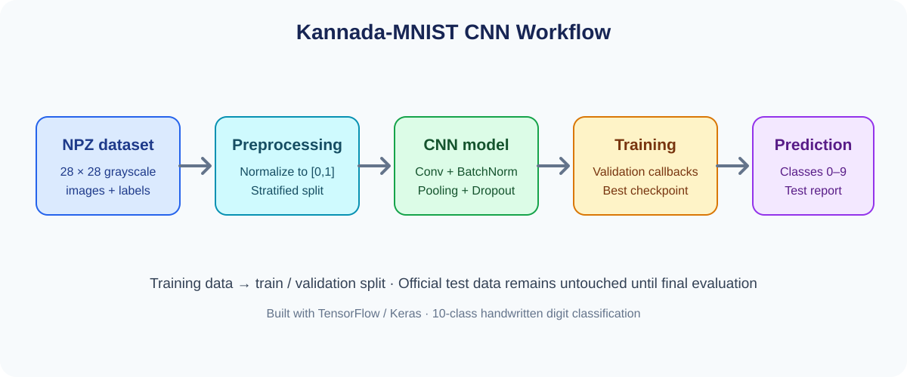

<div align="center">
  
  <br/><br/>
  
  
  
  
</div>

# Kannada-MNIST Handwritten Digit Recognition

A convolutional neural network (CNN) project for classifying handwritten Kannada-MNIST digit images into ten numeric classes (0–9). This repository consolidates a set of original Keras experiments into a reproducible training, evaluation and prediction workflow.

> **Dataset naming:** This project uses the *Kannada-MNIST* dataset (files named `X_kannada_MNIST_*.npz`), not the Japanese Kuzushiji-MNIST dataset that is also commonly abbreviated as KMNIST.

## Project overview

| Component | Details |
|---|---|
| Task | 10-class handwritten digit image classification |
| Dataset format | Four NumPy `.npz` archives |
| Input | 28 × 28 grayscale images |
| Preprocessing | Float32 conversion, normalization to [0, 1], channel dimension |
| Model | CNN with convolution, batch normalization, max pooling and dropout |
| Framework | TensorFlow / Keras |
| Evaluation | Accuracy, precision, recall, F1-score and confusion matrix |

## Workflow



1. Load the provided train and test NPZ files.
2. Normalize image pixels and prepare the grayscale channel dimension.
3. Split only the training partition into stratified train and validation sets.
4. Train a CNN with early stopping and learning-rate reduction.
5. Evaluate the selected checkpoint once on the untouched official test split.
6. Predict a digit class from an individual image.

## Repository structure

```text
kannada-mnist-digit-recognition/
├── data/raw/                         # Place four NPZ dataset files here
├── docs/
│   ├── architecture.svg
│   └── original-code-review.md
├── experiments/original_versions/   # Uploaded Python experiments preserved
├── models/                           # Generated model checkpoints (ignored by Git)
├── notebooks/
│   └── KMNIST-original.ipynb          # Original notebook preserved
├── reports/                          # Generated metrics and plots (ignored by Git)
├── src/kannada_mnist/
│   ├── data.py
│   ├── model.py
│   ├── train.py
│   ├── evaluate.py
│   └── predict.py
├── tests/
├── requirements.txt
└── pyproject.toml
```

## Dataset setup

The original notebook downloads the archive with the Kaggle CLI using dataset identifier `rahulsinhat/kmnist`. The dataset files are not bundled in this repository.

Install the Kaggle CLI and configure your Kaggle credentials locally. Never commit `kaggle.json` or API tokens.

```bash
mkdir -p data/raw
kaggle datasets download -d rahulsinhat/kmnist --unzip -p data/raw
```

The `data/raw/` directory should contain:

```text
X_kannada_MNIST_train.npz
y_kannada_MNIST_train.npz
X_kannada_MNIST_test.npz
y_kannada_MNIST_test.npz
```

The loader reads the `arr_0` key used by the supplied scripts, and supports single-array NPZ files with another single key.

## Installation

Python 3.9 or later is recommended.

```bash
python -m venv .venv
# Windows PowerShell
.venv\Scripts\Activate.ps1
# macOS / Linux
# source .venv/bin/activate

python -m pip install --upgrade pip
pip install -r requirements.txt
pip install -e .
```

## Train

```bash
python -m kannada_mnist.train \
  --data-dir data/raw \
  --epochs 50 \
  --batch-size 128 \
  --validation-fraction 0.1 \
  --seed 42
```

The pipeline creates a reproducible stratified validation split from the training data. The official test split is not used to select epochs or tune the model. The best checkpoint is saved to `models/best_model.keras`, and training history is written to `reports/training_history.json`.

## Evaluate

After training, run final evaluation on the official test split:

```bash
python -m kannada_mnist.evaluate \
  --data-dir data/raw \
  --model models/best_model.keras \
  --output-dir reports
```

This generates:

- `reports/evaluation.json` — aggregate accuracy and per-class classification report
- `reports/confusion_matrix.csv` — confusion matrix values
- `reports/confusion_matrix.png` — confusion matrix visualization

## Predict one image

```bash
python -m kannada_mnist.predict path/to/handwritten-digit.png \
  --model models/best_model.keras
```

The image is converted to grayscale, resized to 28 × 28 pixels and normalized before inference. Prediction output is a class ID from 0 to 9 with its softmax confidence.

## Model design

The cleaned CNN is based on the convolutional patterns in the supplied experiments:

- Convolutional feature extraction with 32, 64, 128 and 256 filters
- Batch normalization
- Max pooling and dropout for regularization
- Dense classification head with ten softmax outputs

## Results and reproducibility

The saved notebook output reports **60,000 training samples and 10,000 test samples**. It contains multiple experiment runs; these should not be merged into one performance claim.

**Important evaluation caveat:** the original notebook versions pass the official test set as `validation_data` during training. Consequently, the historical `val_accuracy` logs are not an untouched final test score, especially after repeated experiment and augmentation changes. The cleaned pipeline separates validation from the training data and reserves the official test set for final evaluation. No new training run or verified metric is claimed in this repository yet.

## Tests

```bash
pytest -q
```

Tests cover NPZ loading, grayscale image conversion, label validation and deterministic stratified splitting. TensorFlow model training requires installing the dependencies and providing the dataset locally.

## Original experiments and notebook audit

The three uploaded scripts and original notebook are kept for provenance under `experiments/original_versions/` and `notebooks/`. The notebook also contains a separate PyQt image-generation utility and an unrelated Streamlit/Gemini chat example; these are not part of the digit-recognition pipeline. See [`docs/original-code-review.md`](docs/original-code-review.md) for details.

## Limitations and next steps

- Re-run training with the cleaned split before publishing benchmark metrics.
- Keep the official test split untouched until final model selection is complete.
- Compare class-wise metrics and inspect confusion patterns.
- Review augmentation carefully; flips are excluded because they can change numeral identity.
- Document the exact dataset source and license before redistributing data or model artifacts.

## Author

**Rahul Sinha**  
GitHub: [Rahul-DSAI](https://github.com/Rahul-DSAI)

---
<div align="center"><sub>Personal computer-vision portfolio project · Kannada handwritten digit recognition</sub></div>
