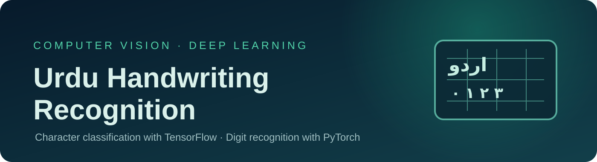
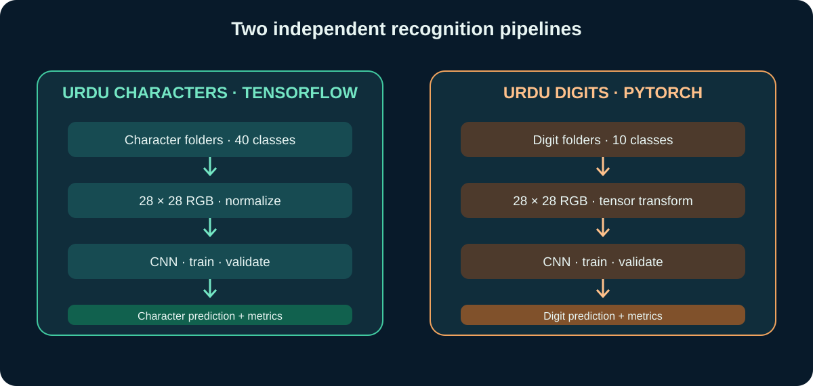

<div align="center">
  

  <p>
    
    
    
    
  </p>
</div>

# Urdu Handwriting Recognition

A personal computer-vision project exploring handwritten **Urdu character classification** and **Urdu digit recognition** using convolutional neural networks (CNNs).

The repository brings together two separate implementations from the supplied experiments:

| Track | Framework | Task | Original setup |
|---|---|---|---|
| Urdu character recognition | TensorFlow / Keras | 40-class character classification | 28 × 28 RGB images, batch size 32, 20 epochs |
| Urdu digit recognition | PyTorch / Torchvision | 10-class digit classification | 28 × 28 RGB images, batch size 64, 30 epochs |

The two tracks use different datasets and frameworks. Their class labels and model checkpoints are kept separate.

> **Scope:** This is an educational and experimental handwritten-image classification project. It has not been validated as an OCR system for full words, sentences, connected Urdu script, or production document processing.

## Project overview

<div align="center">
  
</div>

### 1. Urdu character recognition — TensorFlow

The original TensorFlow script loads class-labelled folders from `characters_train_set` and `characters_test_set`, resizes images to 28 × 28 pixels, scales pixel values to `[0, 1]`, and trains a CNN with 40 output classes.

The refactored implementation adds:
- A fixed training/validation split generated by Keras from the training directory.
- Consistent class ordering between training, validation, and test directories.
- Checkpointing and early stopping.
- Saved class-name metadata.
- A separate evaluation script and single-image prediction command.

### 2. Urdu digit recognition — PyTorch

The original PyTorch script uses `torchvision.datasets.ImageFolder` with `digits_train_set` and `digits_test_set`, resizes images to 28 × 28 pixels, and trains a CNN for 10 classes.

The refactored implementation adds:
- A stratified validation split from the training directory.
- A check that training and test class mappings match.
- A corrected CNN pooling schedule so the feature-map size matches the classifier input.
- Best-checkpoint saving based on validation accuracy.
- Separate evaluation and single-image prediction commands.

## Repository structure

```text
urdu-handwriting-recognition/
├── docs/
│   ├── architecture.svg
│   └── original-code-review.md
├── experiments/
│   └── original/
│       ├── urdhumnist.py
│       └── urdu_pytorch.py
├── src/
│   └── urdu_recognition/
│       ├── __init__.py
│       ├── characters_tf/
│       │   ├── __init__.py
│       │   ├── data.py
│       │   ├── model.py
│       │   ├── train.py
│       │   ├── evaluate.py
│       │   └── predict.py
│       └── digits_torch/
│           ├── __init__.py
│           ├── data.py
│           ├── model.py
│           ├── train.py
│           ├── evaluate.py
│           └── predict.py
├── tests/
│   ├── test_torch_model.py
│   └── test_source_structure.py
├── .gitignore
├── LICENSE_NOTE.md
├── README.md
└── pyproject.toml
```

## Installation

Use Python 3.10 or later. Create a virtual environment first:

```bash
python -m venv .venv

# Windows PowerShell
.venv\Scripts\Activate.ps1

# macOS / Linux
# source .venv/bin/activate

python -m pip install --upgrade pip
pip install -e .
```

Install the framework for the track you plan to run:

```bash
# TensorFlow character classifier
pip install -e ".[characters-tf]"

# PyTorch digit classifier
pip install -e ".[digits-torch]"

# Development tests
pip install -e ".[dev]"
```

For PyTorch GPU training, install a PyTorch build compatible with your CUDA driver and hardware. Refer to the official PyTorch installation selector for the correct command.

## Dataset layout

The datasets are not included in this repository. Use datasets you are permitted to access and process.

### Character dataset

```text
your-data/
├── characters_train_set/
│   ├── class_01/
│   ├── class_02/
│   └── ... 
└── characters_test_set/
    ├── class_01/
    ├── class_02/
    └── ...
```

Each class directory should contain images belonging to that class. Directory names become the class labels. The implementation uses the same sorted class-name order for both train and test sets.

### Digit dataset

```text
your-data/
├── digits_train_set/
│   ├── 0/
│   ├── 1/
│   └── ... 
└── digits_test_set/
    ├── 0/
    ├── 1/
    └── ...
```

The PyTorch `ImageFolder` loader derives labels from folder names. Training and testing folder-to-index mappings must match exactly.

## Train the character classifier

```bash
python -m urdu_recognition.characters_tf.train \
  --train-dir /path/to/characters_train_set \
  --test-dir /path/to/characters_test_set \
  --output-dir artifacts/characters_tf \
  --epochs 20 \
  --batch-size 32
```

Windows PowerShell example:

```powershell
python -m urdu_recognition.characters_tf.train `
  --train-dir "D:\datasets\characters_train_set" `
  --test-dir "D:\datasets\characters_test_set" `
  --output-dir "artifacts\characters_tf" `
  --epochs 20 `
  --batch-size 32
```

The training script writes the best Keras model and class metadata to the output directory.

### Evaluate character model

```bash
python -m urdu_recognition.characters_tf.evaluate \
  --test-dir /path/to/characters_test_set \
  --model artifacts/characters_tf/best_model.keras \
  --class-names artifacts/characters_tf/class_names.json \
  --output-dir artifacts/characters_tf/evaluation
```

### Predict one character image

```bash
python -m urdu_recognition.characters_tf.predict \
  --image path/to/character.png \
  --model artifacts/characters_tf/best_model.keras \
  --class-names artifacts/characters_tf/class_names.json
```

## Train the digit classifier

```bash
python -m urdu_recognition.digits_torch.train \
  --train-dir /path/to/digits_train_set \
  --test-dir /path/to/digits_test_set \
  --output-dir artifacts/digits_torch \
  --epochs 30 \
  --batch-size 64
```

Windows PowerShell example:

```powershell
python -m urdu_recognition.digits_torch.train `
  --train-dir "D:\datasets\digits_train_set" `
  --test-dir "D:\datasets\digits_test_set" `
  --output-dir "artifacts\digits_torch" `
  --epochs 30 `
  --batch-size 64
```

### Evaluate digit model

```bash
python -m urdu_recognition.digits_torch.evaluate \
  --test-dir /path/to/digits_test_set \
  --checkpoint artifacts/digits_torch/best_model.pth \
  --output-dir artifacts/digits_torch/evaluation
```

### Predict one digit image

```bash
python -m urdu_recognition.digits_torch.predict \
  --image path/to/digit.png \
  --checkpoint artifacts/digits_torch/best_model.pth
```

## Model architecture

Both tracks use CNNs with convolutional feature extraction, batch normalization, max pooling, dropout, and a dense classification head. They are implemented independently because the original experiments use different frameworks and different numbers of classes.

## Evaluation

The evaluation scripts report:
- Test accuracy.
- Precision, recall, and F1-score by class and weighted average.
- Confusion matrix.
- Classification report.

No performance numbers are published here because the uploaded source files contain training code but no reproducible saved training logs or model checkpoints. Run the training and evaluation commands with the corresponding datasets to generate results.

## Notes from reviewing the original scripts

The original files are retained in `experiments/original/`.

The refactored versions address several issues identified in the original scripts:
- Hard-coded Windows paths are replaced with command-line arguments.
- Character validation data is created through a fixed Keras validation split rather than taking and skipping from a shuffled dataset on separate iterations.
- Character test loading reuses the training class order.
- Digit validation data is stratified by class.
- The original PyTorch digit CNN applied four max-pooling operations to 28 × 28 inputs but declared a `256 × 7 × 7` fully connected input. The refactored model pools after each pair of convolutional layers, resulting in the intended 7 × 7 feature map.
- Checkpoints include class-name metadata so predictions can be mapped back to the original folder labels.

## Limitations and future work

- Confirm the dataset's class-to-script-symbol mapping before displaying Unicode Urdu characters in predictions.
- Inspect class balance and image quality.
- Compare grayscale and RGB preprocessing.
- Tune augmentation carefully; transformations that alter character identity should be avoided.
- Add per-class error analysis and sample prediction visualizations.
- For connected Urdu words and full document OCR, develop a separate line/word segmentation and sequence-recognition pipeline.

## Author

**Rahul Sinha**  
AI Engineer | Computer Vision | Applied Machine Learning

- GitHub: [Rahul-DSAI](https://github.com/Rahul-DSAI)
- LinkedIn: [Rahul Sinha](https://www.linkedin.com/in/rahul-sinha99/)

---

<div align="center">
  <sub>Personal applied computer-vision project · Urdu handwritten character and digit recognition</sub>
</div>
