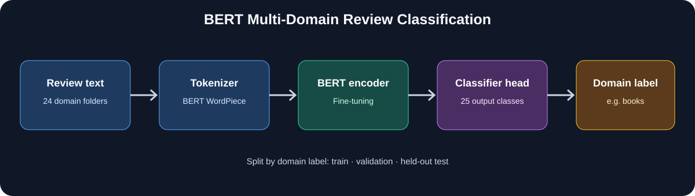

<div align="center">
  

  <br/>
  
  
  
  
</div>

# BERT Multi-Domain Product Review Classification

A text-classification project that fine-tunes **BERT-base-uncased** to classify product reviews into **24 product domains** using the Multi-Domain Sentiment Analysis Dataset's `unprocessed/sorted_data` folder structure.

> **Important task clarification:** Although the supplied notebooks are named *Sentiment Analysis*, the code assigns each review the label of its containing product-domain folder (such as `books`, `apparel`, or `electronics`). The implemented target is therefore **product-domain classification**, not positive/negative/neutral sentiment prediction. See [the original-code review](docs/original-code-review.md).

## What it does

1. Reads `processed.review.balanced` review text from each product-domain folder.
2. Assigns one of 25 product-domain labels.
3. Creates reproducible stratified training, validation, and held-out test partitions.
4. Tokenizes reviews with the BERT tokenizer using dynamic batch padding.
5. Fine-tunes `bert-base-uncased` with a 24-class classification head.
6. Selects the best checkpoint by validation macro-F1.
7. Evaluates the selected checkpoint on the held-out test partition and saves metrics.

## Architecture



## Label classes

The source implementation uses these 25 folder labels, in this order:

`apparel`, `automotive`, `baby`, `beauty`, `books`, `camera_&_photo`, `cell_phones_&_service`, `computer_&_video_games`, `dvd`, `electronics`, `gourmet_food`, `grocery`, `health_&_personal_care`, `jewelry_&_watches`, `kitchen_&_housewares`, `magazines`, `music`, `musical_instruments`, `office_products`, `outdoor_living`, `software`, `sports_&_outdoors`, `tools_&_hardware`, `toys_&_games`, `video`.

## Repository structure

```text
bert-multidomain-review-classification/
├── configs/categories.json
├── docs/
│   ├── architecture.svg
│   ├── original-code-review.md
│   └── project-banner.svg
├── notebooks/original/
│   ├── sentiment.ipynb
│   ├── sentimentanalysis.ipynb
│   └── Sentiment_Analysis_empty.ipynb
├── src/review_classifier/
│   ├── data.py
│   ├── evaluate.py
│   ├── metrics.py
│   ├── modeling.py
│   ├── predict.py
│   └── train.py
├── tests/test_data.py
├── .gitignore
├── pyproject.toml
└── requirements.txt
```

## Dataset

The original notebook downloads the [Multi-Domain Sentiment Analysis Dataset on Kaggle](https://www.kaggle.com/datasets/jeromeblanchet/multidomain-sentiment-analysis-dataset). The dataset is **not included** in this repository.

Download and extract the dataset using Kaggle's documented authentication procedure. The training code expects this directory layout:

```text
<dataset-root>/
└── unprocessed/
    └── sorted_data/
        ├── apparel/processed.review.balanced
        ├── automotive/processed.review.balanced
        ├── baby/processed.review.balanced
        └── ... one folder for each of the 25 domains
```

Pass the `sorted_data` directory itself as `--data-root`. Check the dataset provider's current license and terms before redistribution; do not commit the raw dataset or Kaggle credentials.

## Setup

Python 3.10 or later is recommended. A CUDA-capable GPU is useful for BERT fine-tuning.

```bash
python -m venv .venv
# Windows PowerShell: .venv\Scripts\Activate.ps1
# macOS/Linux: source .venv/bin/activate
python -m pip install --upgrade pip
pip install -r requirements.txt
pip install -e .
```

## Train

Run from the repository root:

```bash
python -m review_classifier.train \
  --data-root /path/to/unprocessed/sorted_data \
  --model-name bert-base-uncased \
  --epochs 3 \
  --batch-size 16 \
  --learning-rate 2e-5 \
  --max-length 256 \
  --output-dir artifacts/bert-multidomain
```

Windows PowerShell example:

```powershell
python -m review_classifier.train `
  --data-root "D:\datasets\unprocessed\sorted_data" `
  --epochs 3 `
  --batch-size 16 `
  --output-dir artifacts\bert-multidomain
```

The pipeline uses a stratified train/validation/test split (default 70%/15%/15%). The held-out test set is not evaluated after every epoch. The best checkpoint is selected using validation macro-F1, then the test set is evaluated once after training.

## Predict a review's product domain

After training:

```bash
python -m review_classifier.predict "The camera takes sharp photos and has a long battery life." \
  --model-dir artifacts/bert-multidomain/best_model
```

Example output shape:

```json
{
  "predicted_domain": "camera_&_photo",
  "class_id": 5,
  "confidence": 0.91
}
```

The values above are illustrative only; actual predictions depend on the trained checkpoint.

## Evaluation

Training saves:

- `best_model/`: model weights, configuration and tokenizer.
- `label_mapping.json`: stable numeric label mapping.
- `split_summary.json`: number of examples in each split.
- `training_history.json`: epoch-level losses and validation metrics.
- `best_validation_metrics.json`: validation classification report and confusion matrix.
- `test_metrics.json`: held-out test accuracy, macro/weighted F1, classification report and confusion matrix.

Metrics are generated only when you run training. The uploaded notebooks do not provide a complete, independently verifiable final performance result, so this README does not claim an accuracy score.

## Notes on the original implementation

The supplied populated notebooks are near-identical versions of the same BERT pipeline; one uses a Kaggle input path and the other a Colab extraction path. The third notebook, `Sentiment_Analysis.ipynb`, contains an empty code cell. The original code also removes English stopwords before BERT tokenization; the cleaned pipeline retains them because negation and other function words can carry important meaning.

## Tests

```bash
pip install -e ".[dev]"
pytest -q
```

## Scope and limitations

- This implementation predicts **one of 24 product domains**, not sentiment polarity.
- The dataset is external and must be downloaded separately.
- The model and metrics are not bundled; train the model to produce them.
- For actual sentiment analysis, use labelled polarity targets (for example, negative/positive or star ratings) and define a separate sentiment label mapping and evaluation protocol.

## Author

**Rahul Sinha**  
GitHub: [Rahul-DSAI](https://github.com/Rahul-DSAI)
