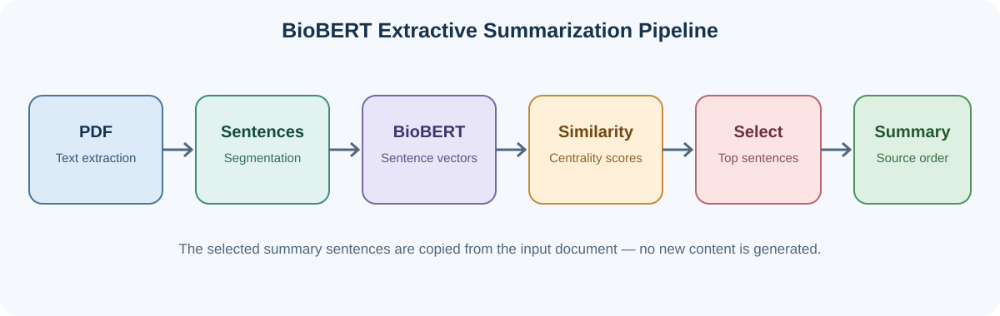

<div align="center">


# BioBERT-Based Medical PDF Extractive Summarization

**Extract key sentences from medical research PDFs using BioBERT sentence embeddings and cosine-similarity centrality.**

[](https://www.python.org/)
[](https://pytorch.org/)
[](https://huggingface.co/dmis-lab/biobert-v1.1)
[](https://en.wikipedia.org/wiki/Automatic_summarization)

</div>

---

## Overview

This project extracts a short summary from a medical research PDF. It extracts text from the PDF, splits the text into sentences, generates contextual sentence embeddings with **BioBERT**, ranks sentences using cosine-similarity centrality, and returns the highest-ranked sentences in their original document order.

This is an **extractive** summarizer: selected sentences are copied from the source document. It does not generate new medical statements and it does not fine-tune BioBERT.

## How it works

<div align="center">
  
</div>

1. **PDF extraction** – read text from the uploaded or local PDF.
2. **Sentence segmentation** – divide the extracted text into candidate sentences.
3. **BioBERT embeddings** – encode each sentence with a biomedical language encoder.
4. **Centrality scoring** – calculate pairwise cosine similarities and score each sentence by its average similarity to the others.
5. **Sentence selection** – select the top-ranked sentences and restore their original order.
6. **Output** – save or display the extractive summary.

## Repository structure

```text
medical-pdf-summarization-biobert/
├── app.py
├── README.md
├── requirements.txt
├── pyproject.toml
├── src/
│   └── medical_summarizer/
│       ├── __init__.py
│       ├── pdf.py
│       ├── text.py
│       ├── embeddings.py
│       ├── summarizer.py
│       └── cli.py
├── experiments/
│   └── original/
│       ├── app.py
│       ├── Datacollection.py
│       ├── model.py
│       ├── Model1.py
│       ├── Model2.py
│       └── model3.py
├── docs/
│   ├── architecture.svg
│   └── original-code-review.md
└── tests/
    ├── test_text.py
    └── test_summarizer.py
```

## Setup

Python 3.10 or later is recommended.

```bash
git clone https://github.com/<YOUR_GITHUB_USERNAME>/medical-pdf-summarization-biobert.git
cd medical-pdf-summarization-biobert

python -m venv .venv

# Windows PowerShell
.venv\Scripts\Activate.ps1

# macOS / Linux
# source .venv/bin/activate

python -m pip install --upgrade pip
pip install -r requirements.txt
pip install -e .
```

The first run downloads the BioBERT tokenizer and model from Hugging Face. A CUDA-enabled GPU is optional; CPU inference is supported but slower.

## Summarize a PDF from the command line

```bash
python -m medical_summarizer.cli path/to/medical-paper.pdf \
  --sentences 5 \
  --output summary.txt
```

Options:

```text
--sentences   Number of source sentences to include (default: 3)
--output      Optional path to save the summary
--model       Hugging Face model identifier (default: dmis-lab/biobert-v1.1)
--batch-size  Number of sentences embedded per batch (default: 16)
```

## Launch the Streamlit application

```bash
streamlit run app.py
```

Upload a text-based PDF, choose the number of sentences, and generate an extractive summary. Scanned PDFs require OCR; OCR is not included in this project. The app displays a clear message if the PDF contains no extractable text.

## Python usage

```python
from medical_summarizer.pdf import extract_pdf_text
from medical_summarizer.embeddings import BioBERTEmbedder
from medical_summarizer.summarizer import summarize_text

text = extract_pdf_text("paper.pdf")
embedder = BioBERTEmbedder()
summary = summarize_text(text, embedder, num_sentences=5)

print(summary)
```

## Method

For sentence embeddings \(e_i\), the implementation computes cosine similarity between each pair of sentences. A sentence's centrality score is the mean of its similarities to the other sentences:

\[
score(i) = \frac{1}{N-1}\sum_{j \ne i} \cos(e_i, e_j)
\]

The highest-scoring sentences are selected. They are then sorted by their original position, so the summary follows the source article's sequence.

The encoder uses attention-mask-aware mean pooling over the last hidden states. Sentences are encoded in batches to limit memory use.

## Evaluation

The uploaded scripts include an example ROUGE evaluation function but do not include reference summaries, a labeled evaluation dataset, or validated benchmark results. Therefore, this repository does **not** claim a ROUGE score or a measured summarization quality.

For a proper evaluation:
- prepare medical documents paired with human-written reference summaries;
- evaluate with ROUGE-1, ROUGE-2 and ROUGE-L;
- include human review for factual consistency, coverage and clinical meaning;
- compare against a simple lead-sentence baseline.

## Important notes about the original experiments

The original archive contains several different approaches and some model/API mismatches. The maintained implementation in `src/` uses the BioBERT encoder for **extractive** summarization. The original scripts are preserved in `experiments/original/` for traceability; see [`docs/original-code-review.md`](docs/original-code-review.md).

In particular, BioBERT is an encoder model, not a sequence-to-sequence text generator. The original `app.py` attempts to load BioBERT weights through `BartForConditionalGeneration`, and `Model1.py` uses `BertForMaskedLM` as if it were a summarization model. Those generative paths are not used by the maintained pipeline.

## Limitations

- PDF text extraction can lose reading order, tables, equations, headers and footnotes.
- Scanned/image-only PDFs need OCR.
- Sentence centrality may select general background sentences and may omit specific findings.
- Extractive summaries can preserve errors or unsupported claims in the source.
- BioBERT embeddings do not constitute clinical validation.
- The system is a research/learning prototype, not a medical decision-support tool.

**Do not use the generated summary as a substitute for reading the original paper or for clinical decision-making. Verify important medical claims against the source document.**

## Tests

```bash
pytest -q
```

The tests cover sentence segmentation and the ranking/ordering logic without downloading the BioBERT model.

## Author

**Rahul Sinha**  
AI Engineer | Applied AI & NLP

- GitHub: [Rahul-DSAI](https://github.com/Rahul-DSAI)
- LinkedIn: [Rahul Sinha](https://www.linkedin.com/in/rahul-sinha99/)

---

<div align="center">
  <sub>Personal applied-NLP project for extracting salient sentences from biomedical literature.</sub>
</div>
