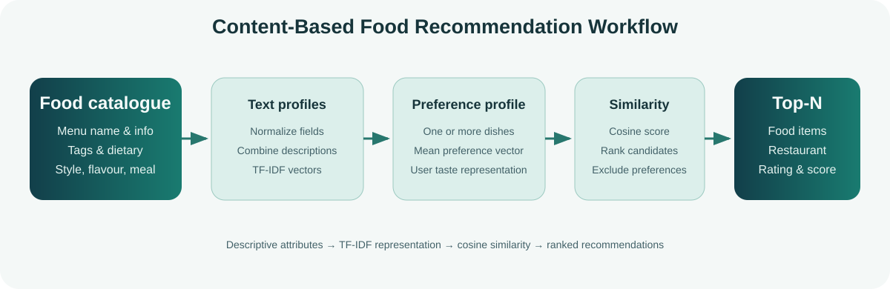

<div align="center">
  

  <br />

  
  
  
  
</div>

# Food Recommendation System

A content-based recommendation prototype that ranks menu items according to how closely their descriptions and attributes match a user's preferred food. It uses TF-IDF text features and cosine similarity across menu category, description, tags, dietary attributes, preparation style, presentation, food concept, flavour and mealtime.

> **Scope:** This is a small academic demonstration using the supplied menu catalogue (38 candidate items) and preference examples (13 rows). It is not a production-scale recommender and has not been evaluated against real user feedback.

## How it works

<div align="center">
  
</div>

1. Load candidate menu items and user preference examples.
2. Normalize descriptive fields and create a text profile per food item.
3. Convert profiles into TF-IDF vectors.
4. Build a preference profile from one or more selected foods, or from all preference examples.
5. Compute cosine similarity between catalogue vectors and the preference profile.
6. Return the top-N items, with user ratings displayed as metadata and used only as a tie-break.

## Repository structure

```text
food-recommendation-system/
├── data/
│   ├── food_data.csv
│   └── user_preferences.csv
├── docs/
│   ├── algorithm-notes.md
│   ├── architecture.svg
│   ├── data-notes.md
│   ├── original-assignment-readme.md
│   └── original-variants.md
├── experiments/
│   └── original_variants/
│       ├── torch_onehot/
│       ├── countvectorizer_knn/
│       └── tfidf_cosine/
├── src/food_recommender/
│   ├── __init__.py
│   ├── __main__.py
│   ├── cli.py
│   └── recommender.py
├── tests/
├── .gitignore
├── pyproject.toml
└── requirements.txt
```

## Dataset

The included CSV files are taken from the uploaded project archives:

- `food_data.csv`: 38 menu items and 12 columns, including `UserRating`.
- `user_preferences.csv`: 13 preferred food examples and 11 columns.

The source columns include `foodCategoryName`, `foodItemName`, `foodInfo`, `restaurantName`, `tags`, `Dietary`, `FoodPreparationStyles`, `FoodPresentation`, `FoodConcepts`, `Flavortype` and `Mealtime`. The inspected files contain no missing values, and the 38-item catalogue has no duplicate item names.

**Data rights:** The uploaded files do not state the data licence or redistribution terms. Before making this repository public, confirm that you have permission to redistribute menu descriptions, restaurant names and ratings. See [data notes](docs/data-notes.md).

## Setup

Python 3.10 or later is recommended.

```bash
# Clone your repository
git clone https://github.com/<YOUR_GITHUB_USERNAME>/food-recommendation-system.git
cd food-recommendation-system

# Create and activate a virtual environment
python -m venv .venv
# Windows PowerShell: .venv\Scripts\Activate.ps1
# macOS/Linux: source .venv/bin/activate

python -m pip install --upgrade pip
pip install -r requirements.txt
pip install -e .
```

## Run recommendations

Use one preferred item from the supplied preference examples:

```bash
python -m food_recommender \
  --preferred-food "Lunch Sashimi" \
  --top-n 10
```

Use multiple preferred items to build a combined taste profile:

```bash
python -m food_recommender \
  --preferred-food "Hummus & Falafel" \
  --preferred-food "Gyro Wrap" \
  --top-n 10
```

Use all rows in `user_preferences.csv` as a combined preference profile:

```bash
python -m food_recommender --top-n 10
```

Save the recommendations to CSV:

```bash
python -m food_recommender \
  --preferred-food "Lunch Sashimi" \
  --top-n 10 \
  --output outputs/lunch-sashimi-recommendations.csv
```

Custom data paths are supported with `--catalog` and `--preferences`. Run `python -m food_recommender --help` for all options.

## Recommendation method

The consolidated version uses TF-IDF and cosine similarity on descriptive text fields. The `UserRating` field is not part of the similarity representation, which avoids allowing ratings to determine content similarity. Ratings are displayed and used only as a secondary sort key when similarity scores tie.

The supplied archives also contain earlier experiments with a PyTorch one-hot baseline and CountVectorizer/k-nearest-neighbours. Their source files are preserved under `experiments/original_variants/`; see [algorithm notes](docs/algorithm-notes.md) for limitations and the reason the TF-IDF content-based method was chosen as the consolidated baseline.

## Example output

The CLI returns a ranked table with:

| Column | Meaning |
|---|---|
| `foodCategoryName` | Menu category |
| `foodItemName` | Recommended dish |
| `restaurantName` | Restaurant listed in the dataset |
| `UserRating` | Rating supplied in the source CSV |
| `Similarity_Score` | Cosine similarity to the preference profile |

Scores are relative to this small catalogue and feature representation; they are not probabilities or measures of user satisfaction.

A sample run for the preference item `Lunch Sashimi` produces the following top-five results from the bundled CSV files:

| Food item | Restaurant | Rating | Similarity |
|---|---|---:|---:|
| Chicken Teriyaki Lunch | Teriyaki Grill | 4.5 | 0.107 |
| Shrimp with Broccoli | Aya Asian Fusion | 4.1 | 0.078 |
| Greek Salad | Salad House | 4.4 | 0.071 |
| Tacos Del Mar | La Hacienda Downtown Dover | 4.8 | 0.055 |
| Pollo Asado Tacos Combo | El Fenix Carniceria | 4.7 | 0.052 |

The full run is saved in [`examples/lunch_sashimi_recommendations.csv`](examples/lunch_sashimi_recommendations.csv). This is an output example, not a quality benchmark.

## Tests

```bash
pip install pytest
pytest -q
```

The tests check data loading, ranking, score range, selected-item exclusion, unknown preferences and invalid `top_n` values.

## Limitations and next steps

- The dataset is very small (38 candidate items), so recommendations are illustrative.
- No clicks, purchases, ratings from an identified user, or relevance judgements are supplied for offline evaluation.
- Precision@K, Recall@K, NDCG and similar quality claims should not be reported without relevance labels or feedback.
- Current ranking is content-based; collaborative filtering and hybrid ranking would require user-item interaction data.
- Dietary values are descriptive dataset metadata, not verified allergy or medical safety information.
- Restaurant availability, menus and ratings may change; this project does not query live restaurant data.

## Personal project

Maintained as an individual portfolio project by **Rahul Sinha**.

- GitHub: [Rahul-DSAI](https://github.com/Rahul-DSAI)
- LinkedIn: [Rahul Sinha](https://www.linkedin.com/in/rahul-sinha99/)

---

<div align="center"><sub>Built as an applied machine-learning project exploring content-based recommendation.</sub></div>
